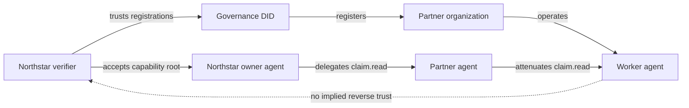
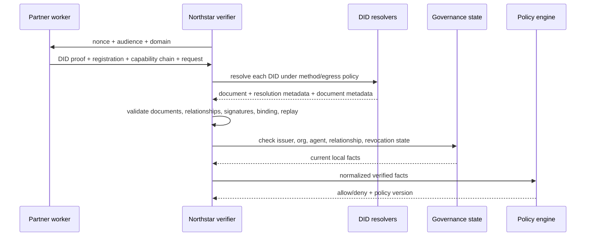

# Decentralized Identity and Trust for Multi-Agent Ecosystems

> **Goal:** authenticate an agent controlled outside your identity domain, establish exactly which external claims your organization accepts, and authorize one bounded action without assuming that a DID, credential, reputation score, or trust path is permission.

## Why this course exists

A decentralized identifier can let an agent prove control of a key without asking your identity provider to create an account first. That solves only one part of a cross-organization transaction.

It does **not** prove that:

- the agent belongs to the organization it names;
- the organization is an approved partner;
- the agent is registered for a specific function;
- a delegation is current or sufficiently narrow;
- another organization’s trust decision should be inherited;
- a discovered service endpoint is safe to call; or
- the requested action is authorized now.

The production question is therefore not “is this DID valid?” It is:

> Does this caller currently control the expected DID, carry evidence from locally accepted authorities, possess a valid attenuated delegation, and satisfy local policy for this exact tenant, purpose, audience, action, and resource?

This course builds that complete decision.

## Learning outcomes

By the end, you can:

1. distinguish identifiers, controllers, credentials, trust anchors, reputation, and authorization;
2. parse DIDs and enforce a local DID-method policy;
3. derive an Ed25519 `did:key` using multicodec and multibase;
4. map `did:web` identifiers to HTTPS URLs without path confusion or unrestricted network access;
5. validate DID documents, metadata, key material, verification relationships, and services;
6. handle deactivation, key rotation, resolver caching, and high-assurance resolver disagreement;
7. verify a short-lived DID-controller proof bound to a verifier, domain, nonce, and replay identifier;
8. verify a signed registration credential under an exact issuer/type/claim policy;
9. validate a signed, parent-bound, attenuated capability chain;
10. model directed, non-transitive trust with NetworkX;
11. feed verified facts—not raw tokens—into OPA or Cedar; and
12. measure a hardened design against a deliberately weak authentication-only baseline.

## Prerequisites

Complete Advanced 2–5 first. You should be comfortable with public-key signatures, JWT validation, credential status, delegation attenuation, federation, policy engines, and fail-closed authorization.

Estimated time: 5–7 hours.

## Run the course

From the repository root:

```bash
python3 -m pip install -r curriculum/advanced/06-decentralized-identity-multi-agent-trust/requirements.txt
python3 curriculum/advanced/06-decentralized-identity-multi-agent-trust/lab.py
pytest -q curriculum/advanced/06-decentralized-identity-multi-agent-trust/tests/test_trust.py
```

Open `advanced_06_decentralized_identity.ipynb` for the guided lab. The lab is deterministic and makes no network calls.

Expected executable result:

```text
hardened: 42/42; invalid allows=0
authentication-only baseline invalid allows=25
release gate: PASS
```

## Course map

| Module | Question | Practical artifact |
|---|---|---|
| 1. Trust vocabulary | What does each artifact actually prove? | evidence-to-decision matrix |
| 2. DID methods | How is a DID created, resolved, updated, and deactivated? | method-selection rubric |
| 3. Safe resolution | How can resolution itself be attacked? | strict `did:web` and `did:key` resolver |
| 4. Controller proof | How does the caller prove present key control? | Ed25519 challenge response |
| 5. Portable claims | Which issuer may assert which claim? | signed registration profile |
| 6. Delegation | How does authority cross agent boundaries safely? | two-hop capability chain |
| 7. Local authorization | How are external facts constrained locally? | Python, OPA, and Cedar policy views |
| 8. Operations | What happens during rotation, deactivation, or compromise? | cache, quorum, and revocation exercises |
| 9. Evaluation | Which attacks does authentication alone miss? | 42-case adversarial corpus |

---

## 1. The trust stack

Keep these concepts separate:

| Layer | Example | What it can establish | What it cannot establish alone |
|---|---|---|---|
| Identifier | `did:web:agents.partner.example:investigator` | stable name in a DID method | current controller, employer, permission |
| Resolution | DID document plus metadata | current verification methods and method state | whether this verifier trusts the subject |
| Controller proof | signed nonce/audience/domain | possession of an authorized authentication key | organization, role, delegation |
| Credential | registration signed by governance | issuer-authored claims about the subject | that the issuer is locally authoritative |
| Capability | owner → partner → worker | bounded delegated authority | current local status or policy compliance |
| Local registry | approved issuer, root, org, methods | the verifier’s trust anchors and constraints | cryptographic validity of presented evidence |
| Current state | active/suspended/revoked/quarantined | negative and lifecycle facts now | past proof validity |
| Policy decision | allow/deny plus evidence | whether this exact request is permitted | future requests or unrelated resources |

A signature proves authorship and integrity. It does not grant the signer unlimited authority to make every possible claim.

### Directed trust is not transitive

If Northstar trusts a governance issuer, and that issuer registers Partner Inc., Northstar has not automatically accepted every claim Partner Inc. makes. Trust edges are directional and purpose-specific.



The notebook uses `networkx.DiGraph` to show reachability without converting paths into direct trust edges.

---

## 2. Standards landscape as of October 2026

Status labels matter. A Recommendation, Candidate Recommendation, community specification, and product implementation do not carry the same stability or conformance meaning.

| Area | Current reference | Status and course use |
|---|---|---|
| DID data model | W3C DID Core 1.0 | Recommendation; normative baseline |
| DID evolution | W3C DID Core 1.1 | Candidate Recommendation Snapshot, 5 March 2026; track but do not silently treat as final |
| Resolution | DID Resolution 1.0 | Candidate Recommendation Draft in 2026; model result/document metadata explicitly |
| Method selection | DID Method Rubric 2.0 | W3C Group Note; evaluate governance, privacy, security, operations, and sustainability—not one score |
| Web method | `did:web` | W3C CCG method specification; WebPKI/domain-control trade-offs |
| Key method | `did:key` | CCG method; self-certifying and offline, but no general rotation/deactivation mechanism |
| Credentials | Verifiable Credentials Data Model 2.0 | W3C Recommendation, 15 May 2025 |
| JOSE/COSE credentials | VC JOSE/COSE | W3C Recommendation, 15 May 2025 |
| Presentation | OpenID4VP 1.0 | OpenID Final, July 2025; verifier challenge and audience binding |
| Issuance | OpenID4VCI 1.0 | OpenID Final, September 2025; OAuth-protected issuance API |
| Federation | OpenID Federation 1.1 | OpenID Final, May 2026; governed trust-chain alternative/complement |
| Secure messaging | DIDComm Messaging 2.1 | DIF Ratified Specification; messaging, not authorization |

This lab uses compact JWT envelopes because they are easy to inspect and supported by common Python libraries. Its registration and capability profiles are explicitly course-specific. A signed JWT that contains a `vc` member is not automatically a conforming VC implementation. Production systems must choose a standardized securing and exchange profile, run its conformance tests, and document every deviation.

### Decentralized identity and federation can coexist

Use a DID when portable controller discovery is useful. Use OpenID Federation when governed entity metadata and trust chains solve the problem more directly. Use workload identity when both parties operate in a tightly governed infrastructure plane. Real systems can bridge these mechanisms, but every bridge needs an explicit trust mapping.

---

## 3. DID methods are security architectures

A DID method defines how identifiers are created, resolved, updated, and deactivated. Therefore “supports DIDs” is not a sufficient security statement.

Evaluate a candidate method across:

- authority and governance;
- resolution integrity and availability;
- key rotation, recovery, and deactivation;
- metadata freshness and versioning;
- privacy, correlation, and enumeration;
- cost, latency, finality, and operational complexity;
- ecosystem maturity and conformance evidence;
- jurisdiction and dependency risk; and
- cryptographic agility.

### `did:web`

`did:web:agents.partner.example:investigator` maps to:

```text
https://agents.partner.example/investigator/did.json
```

Benefits: familiar HTTPS operations, simple publication, WebPKI integration. Trade-offs: DNS, certificate authorities, hosting, and domain recovery remain trust dependencies. It is portable naming over the Web, not independence from centralized infrastructure.

The method specification permits an encoded port. This course’s local policy rejects ports, IP literals, user information, non-HTTPS URLs, traversal segments, and hosts outside an allowlist. Method capability and verifier policy are different layers.

### `did:key`

The lab constructs an Ed25519 identifier as:

```text
did:key:z + base58btc(multicodec(ed25519-pub) || raw-public-key)
```

The Ed25519 public-key multicodec prefix is `0xed01`. `did:key` is useful for ephemeral or low-infrastructure identities and offline fixtures. Its self-certification does not provide a general update, recovery, or deactivation channel, so this course does not use it as the high-risk enterprise agent identity.

### Method policy

Allowing a method means accepting its complete security and operational model. The trust registry therefore contains an exact `allowedDidMethods` list. A controller cannot downgrade the verifier by presenting a valid DID from a method the verifier did not approve.

---

## 4. Safe resolution

Resolution is untrusted input processing plus network access. A production resolver can be attacked through identifier parsing, redirects, DNS rebinding, content-type confusion, oversized documents, cache poisoning, stale data, method plugins, and malicious service endpoints.

The lab follows this sequence:

1. parse the DID and reject unsupported methods;
2. construct the method-specific target under local policy;
3. resolve from deterministic fixtures rather than the public network;
4. require exact document-ID equality;
5. inspect DID document and DID resolution metadata;
6. reject deactivated identities;
7. validate every verification method and relationship reference;
8. reject public documents containing private JWK material;
9. apply strict service-endpoint egress policy; and
10. cache for a bounded TTL and support explicit refresh after rotation.

### Resolution result layers

Do not collapse these into one object:

- **DID resolution metadata:** content type, retrieval source, error information;
- **DID document:** identifier, controllers, verification methods, services;
- **DID document metadata:** deactivation, version, update time, equivalent IDs.

An unexpired signature can still be invalid if the authoritative DID state is deactivated or the referenced method was rotated out.

### High-assurance quorum

For the high-assurance route, the lab asks two independently configured fixture resolvers for the same version and document digest. Disagreement denies the request. This is a course control, not a DID Resolution requirement; a production design must decide whether independent resolver implementations and upstream paths provide meaningful fault separation.

### Service endpoints are not authority

A DID service can advertise an inbox, agent card, or messaging endpoint. It does not authorize a call, make the response trustworthy, or override egress policy. Never fetch arbitrary endpoints simply because a signed DID document contains them.

---

## 5. Verification relationships

A DID document can associate a key with a purpose:

- `authentication`: prove control in an authentication ceremony;
- `assertionMethod`: make signed assertions such as credentials;
- `capabilityInvocation`: invoke or sign capability operations;
- `capabilityDelegation`: delegate capabilities in profiles that use it;
- `keyAgreement`: derive shared secrets.

Key presence is insufficient. The lab rejects an otherwise valid signature when the key is not authorized for the required relationship. This prevents an encryption or assertion key from silently becoming an administrative capability key.

The lab accepts public Ed25519 JWK and Multikey material. It rejects unknown key shapes, unsupported multicodecs, duplicates, foreign controllers, dangling relationship references, and private JWK `d` values.

---

## 6. DID-controller proof

The worker signs a short-lived challenge envelope containing:

```json
{
  "iss": "did:web:agents.partner.example:investigator",
  "sub": "did:web:agents.partner.example:investigator",
  "aud": "https://verifier.northstar.example/agent-access",
  "domain": "verifier.northstar.example",
  "nonce": "fresh-verifier-challenge",
  "iat": 1800000000,
  "nbf": 1800000000,
  "exp": 1800000120,
  "jti": "single-use-proof-id"
}
```

The protected header fixes `alg=EdDSA`, `typ=did-auth+jwt`, and an exact `kid`. Verification requires:

- exact issuer and subject DID;
- exact audience, domain, and nonce;
- an active, validated DID document;
- a `kid` in the `authentication` relationship;
- a valid Ed25519 signature;
- acceptable issued/not-before/expiry times and lifetime; and
- atomic single use of `jti`.

This proves present controller-key possession in one transaction. It is not an employment record or authorization grant.

---

## 7. Registration credential

The Northstar governance DID signs a bounded registration credential asserting that the worker:

- has the exact subject DID;
- is operated by the approved partner organization;
- belongs to the `claims-investigator` agent class; and
- has active registration status.

The verifier checks the governance DID’s `assertionMethod`, exact issuer, exact audience, credential type, closed claim set, subject equality, time bounds, local organization/class policy, and current revocation state.

Why a closed claim set? Credential systems are extensible. An attacker may add a plausible `isAdmin`, `approved`, or `risk=low` field to a legitimately signed object. A verifier must know which schema and claims an issuer is authoritative for; a signature cannot supply that governance decision.

The profile in `lab.py` is a pedagogical signed envelope. For production VC exchange, use VC Data Model 2.0 with an approved securing mechanism and a protocol such as OpenID4VCI/OpenID4VP, including schema, status, holder binding, privacy, and conformance requirements.

---

## 8. Parent-bound capability delegation

The scenario delegates one claims task:

```text
Northstar owner --claim.read + claim.comment--> Partner agent
Partner agent   --claim.read-----------------> Worker agent
```

Each capability is signed with a key authorized for `capabilityInvocation`. The child names the SHA-256 digest of the exact serialized parent token. Verification enforces:

- configured root issuer;
- exact issuer-to-subject continuity;
- parent digest binding;
- no issuer cycle;
- maximum depth;
- child actions ⊆ parent actions;
- child resources ⊆ parent resources;
- exact tenant, purpose, and audience;
- child validity contained within parent validity;
- exact final delegate; and
- current revocation state for every link.

The request must still match the leaf capability. A valid grant for `claim.read` on `claim:483` does not allow `claim.approve`, `claim:999`, another tenant, or model-training use.

Capabilities complement registration credentials: the credential describes governed attributes; the capability carries authority. Neither replaces current local policy.

---

## 9. Complete authorization pipeline



The executable policy checks in order:

1. request-agent method policy;
2. high-assurance resolver agreement;
3. DID-controller proof;
4. registration credential;
5. capability chain;
6. current organization status;
7. current agent status;
8. current organization-agent relationship; and
9. exact request scope.

Only normalized, provenance-preserving facts should reach OPA or Cedar. Never ask a policy engine to trust caller-supplied booleans such as `credentialValid: true`.

### Normalized policy input

```json
{
  "principal": {
    "did": "did:web:agents.partner.example:investigator",
    "did_method": "web",
    "status": "active",
    "organization_status": "active",
    "relationship_status": "active"
  },
  "assurance": {
    "did_control_valid": true,
    "resolver_agreement": true,
    "registration_valid": true,
    "delegation_valid": true
  },
  "request": {
    "tenant": "tenant:northstar",
    "purpose": "claim-review",
    "audience": "https://verifier.northstar.example/agent-access",
    "action": "claim.read",
    "resource": "claim:483"
  }
}
```

The OPA and Cedar examples express the same fail-closed constraints. Cryptographic verification remains in a trusted enforcement component using mature libraries.

---

## 10. Threat model

| Threat | Unsafe shortcut | Control in the lab |
|---|---|---|
| forged controller proof | decode without signature verification | Ed25519 verification against relationship-bound key |
| key confusion | accept any key in the DID document | exact `kid` plus verification relationship |
| document substitution | trust returned JSON | requested DID must equal document `id` |
| SSRF | fetch arbitrary `did:web` or service URLs | HTTPS, host allowlist, IP/userinfo/path rejection |
| stale rotation | cache indefinitely | bounded TTL, invalidation, refresh, version metadata |
| resolver compromise | one answer becomes truth | independent-result agreement for high assurance |
| replay | valid proof accepted repeatedly | nonce, audience, domain, expiry, atomic `jti` consumption |
| claim injection | accept every signed field | exact registration schema and issuer authority |
| delegation amplification | verify only signatures | action/resource/context/lifetime subset checks |
| chain splicing | trust adjacent names | digest-bound parent plus issuer/sub continuity |
| transitive trust | infer direct trust from a path | explicit local roots and directed edges |
| reputation laundering | convert a score into permission | reputation is input only; credential/delegation still required |
| Sybil identities | count identifiers as trust | identity creation never changes local trust anchors |
| stale lifecycle state | rely on original expiry | current deactivation, revocation, quarantine, and relationship state |

Privacy threats also matter. Public, stable DIDs and reusable credentials can enable correlation. Consider pairwise identifiers, selective disclosure, minimal claims, bounded retention, and purpose-specific audit records. Do not put secrets or personal data in a public DID document.

---

## 11. Tools and libraries

The runnable lab uses:

| Tool | Role | Boundary |
|---|---|---|
| `cryptography` | Ed25519 keys and verification | production keys belong in KMS/HSM-backed signers |
| `PyJWT` | compact JOSE envelopes | strict profile checks wrap the generic library |
| `NetworkX` | directed trust-graph analysis | paths remain analysis, not implicit authorization |
| `pytest` | 85 focused tests, including all 42 labeled cases | tests are evidence, not protocol certification |
| `pandas` | notebook comparison tables | presentation only |

Common ecosystem projects to evaluate include the DIF Universal Resolver, `did-resolver` in JavaScript, Veramo, Hyperledger Aries Cloud Agent Python, OpenWallet Foundation Credo, and commercial/open-source credential stacks. Selection should follow the DID Method Rubric, supported methods and proof suites, conformance results, maintenance health, security advisories, deployment model, key custody, and privacy requirements.

Do not introduce a universal resolver into a high-assurance path as an opaque URL fetcher. Pin allowed drivers, isolate it, constrain egress, bound response size/time, retain version/provenance metadata, and monitor cache behavior.

---

## 12. Operations and incident response

### Rotation

1. publish the new verification method and version;
2. allow a bounded overlap only if the method/profile defines it;
3. invalidate resolver and verifier caches;
4. issue new proofs with the new `kid`;
5. remove the old relationship or key;
6. verify that stale-cache requests fail safely; and
7. record version, digest, resolver source, and decision policy.

### Compromise or deactivation

1. suspend the local agent and organization relationship immediately;
2. revoke registration credentials and active capabilities;
3. deauthorize the compromised method in the DID state when supported;
4. invalidate caches and active sessions;
5. block pending irreversible work and reauthorize at commit time;
6. preserve tamper-evident decision evidence; and
7. recover through an independently governed path.

### Availability

Decide deliberately whether cached positive state may be used when a resolver is unavailable. High-risk writes should generally fail closed or degrade to a separately approved break-glass path. Negative state should never be relaxed merely because its source is unavailable.

### Evidence to log

Log identifiers and digests rather than raw credentials where possible:

- request and decision IDs;
- DID, method, document version, and document digest;
- resolver identity/source and cache status;
- verification-method `kid` and relationship;
- credential issuer/type/status reference/digest;
- capability IDs, parent digests, and attenuation result;
- local trust-registry and policy versions;
- action, resource, tenant, purpose, audience;
- outcome and stable reason code.

Redact nonessential claims and never log private keys or bearer tokens.

---

## 13. Guided lab

### Part A — inspect identity artifacts

Run the cells that construct deterministic Ed25519 keys and DID documents. Confirm that the public document contains only public material and that each key purpose is explicit.

### Part B — attack resolution

Try an IP-literal `did:web`, path traversal, document substitution, unsafe service endpoint, deactivated document, stale cache, and disagreeing resolver. Explain which layer rejects each case.

### Part C — prove DID control

Inspect the protected header and challenge claims. Then change the signature, `kid`, nonce, audience, domain, subject, expiry, and replay identifier one at a time.

### Part D — verify governed claims

Change the registration issuer, subject, organization, class, status, and lifetime. Observe that a cryptographically valid but unauthorized assertion still fails.

### Part E — attenuate delegation

Attempt action, resource, purpose, tenant, audience, and lifetime amplification. Break the parent digest and issuer/subject continuity. Revoke the leaf capability.

### Part F — compare architectures

Run all 42 cases through:

- the hardened end-to-end verifier; and
- the authentication-only baseline.

The hardened design must have zero invalid allows and zero valid blocks. The baseline is intentionally unsafe because it mistakes controller authentication for authorization.

### Part G — policy and operations

Map the normalized facts into the supplied Rego and Cedar examples. Design cache, rotation, deactivation, audit, and outage behavior for your own risk tier.

---

## 14. Exercises

### Beginner

1. Explain why `did:web` is not independent of DNS, WebPKI, or hosting.
2. Show the exact HTTPS URL for a root and path-based `did:web` identifier.
3. Identify the claim that binds a proof to one verifier and one transaction.

### Intermediate

1. Add an allowlisted service type without allowing arbitrary egress.
2. Add an `updated` freshness policy to resolution metadata.
3. Add a second approved agent class and prove an unknown class still fails.
4. Convert the registration fixture to a standards-conforming VC 2.0 representation and document the securing profile.

### Advanced

1. Replace fixture resolution with two isolated resolver adapters and preserve provenance.
2. Add key-overlap rules that accept the new key but reject a removed old key.
3. Add capability `capabilityDelegation` semantics and compare them with the current invocation-key profile.
4. Model resolver outage policy for read, write, and irreversible financial actions.
5. Integrate OpenID4VP for presentation and bind the result to the same local authorization request.

### Enterprise design review

Produce a decision record covering:

- why a DID is preferable to federation or workload identity for this boundary;
- approved methods and method-specific risks;
- authoritative issuers by credential type and claim;
- resolver topology, egress, cache, quorum, and outage policy;
- key custody, rotation, deactivation, and recovery;
- capability format, attenuation, depth, and revocation;
- privacy and correlation controls;
- policy-engine contract and provenance;
- observability and evidence retention; and
- conformance, interoperability, and incident-response testing.

---

## 15. Knowledge check

1. What does a DID-controller proof establish?
2. Why must the document `id` equal the requested DID?
3. What is the difference between resolution metadata and DID document metadata?
4. Why can a key in `assertionMethod` not automatically invoke a capability?
5. Why is `did:key` difficult to use for recoverable enterprise identities?
6. Why must a verifier scope issuer authority by credential type and claim?
7. Which fields prevent a controller proof from being replayed across transactions and verifiers?
8. What makes a child capability an attenuation rather than an amplification?
9. Why does a trust-graph path not imply direct authorization?
10. When might OpenID Federation be a better fit than a DID-based design?

Answers should identify the relevant trust boundary, authoritative source, freshness rule, and fail-closed behavior.

---

## 16. Production checklist

- [ ] Business need justifies decentralized identifiers.
- [ ] Allowed DID methods and their governance are documented.
- [ ] DID parser and method adapters have adversarial tests.
- [ ] Resolution is isolated with strict egress, limits, provenance, and cache policy.
- [ ] Document-ID equality and deactivation are enforced.
- [ ] Verification relationships are purpose-bound.
- [ ] Private material is rejected from public documents.
- [ ] Controller proofs bind issuer, subject, key, audience, domain, nonce, time, and replay ID.
- [ ] Credential issuer authority is scoped by type, schema, and claim.
- [ ] Credential and capability revocation fail closed for high-risk actions.
- [ ] Delegation is parent-bound, continuous, depth-limited, and attenuating.
- [ ] Organization, agent, and relationship state are checked locally.
- [ ] External reputation or discovery never directly grants permission.
- [ ] OPA/Cedar receives verified normalized facts with provenance.
- [ ] Rotation, resolver disagreement, outage, deactivation, and recovery are rehearsed.
- [ ] Audit evidence is useful without retaining unnecessary personal data or tokens.
- [ ] Protocol conformance suites and cross-vendor tests are part of release gates.

---

## References

### Normative and protocol sources

- W3C, [Decentralized Identifiers (DIDs) v1.0](https://www.w3.org/TR/did-core/)
- W3C, [Decentralized Identifiers (DIDs) v1.1](https://www.w3.org/TR/did-1.1/)
- W3C, [DID Resolution](https://www.w3.org/TR/did-resolution/)
- W3C, [DID Method Rubric 2.0](https://www.w3.org/TR/did-rubric/)
- W3C Credentials Community Group, [`did:web` Method Specification](https://w3c-ccg.github.io/did-method-web/)
- W3C Credentials Community Group, [`did:key` Method v0.9](https://w3c-ccg.github.io/did-key-spec/)
- W3C, [Controlled Identifiers v1.0](https://www.w3.org/TR/cid-1.0/)
- W3C, [Verifiable Credentials Data Model v2.0](https://www.w3.org/TR/vc-data-model-2.0/)
- W3C, [Securing Verifiable Credentials using JOSE and COSE](https://www.w3.org/TR/vc-jose-cose/)
- OpenID Foundation, [OpenID for Verifiable Presentations 1.0 Final](https://openid.net/specs/openid-4-verifiable-presentations-1_0-final.html)
- OpenID Foundation, [OpenID for Verifiable Credential Issuance 1.0](https://openid.net/specs/openid-4-verifiable-credential-issuance-1_0.html)
- OpenID Foundation, [OpenID Federation 1.1 Final](https://openid.net/specs/openid-federation-1_1-final.html)
- Decentralized Identity Foundation, [DIDComm Messaging v2.1](https://identity.foundation/didcomm-messaging/spec/v2.1/)
- IETF, [RFC 8725: JSON Web Token Best Current Practices](https://www.rfc-editor.org/rfc/rfc8725)
- IETF, [RFC 8037: CFRG Elliptic Curve Algorithms for JOSE](https://www.rfc-editor.org/rfc/rfc8037)

### Implementation and evaluation resources

- DIF, [Universal Resolver](https://github.com/decentralized-identity/universal-resolver)
- OWASP, [Server Side Request Forgery Prevention Cheat Sheet](https://cheatsheetseries.owasp.org/cheatsheets/Server_Side_Request_Forgery_Prevention_Cheat_Sheet.html)
- W3C, [VC Data Model 2.0 Implementation Report](https://w3c.github.io/vc-data-model-2.0-test-suite/)

## Next course

Advanced 7 applies these trust lessons to non-human identity security and key management: custody, secretless federation, rotation, compromise containment, and recovery at agent scale.
